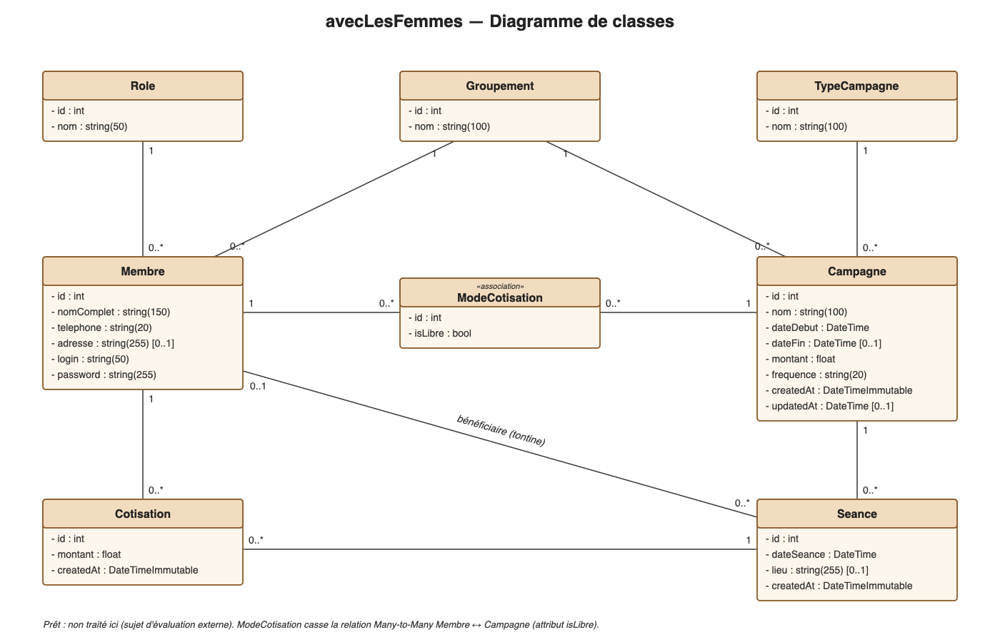

# avecLesFemmes

Application de gestion des calebasses participatives (épargne et tontine) pour des groupements de femmes.
Projet Symfony 8 — Mohamed Madani.

## Modélisation



| Entité | Rôle |
|---|---|
| `Groupement` | Le groupement de femmes |
| `Role` | Admin, Trésorier, Secrétaire, Membre simple |
| `Membre` | Une femme du groupement (nom complet, téléphone, adresse, login, mot de passe) |
| `TypeCampagne` | Épargne, Tontine… (table séparée car les types peuvent évoluer, ex. « prêt » plus tard) |
| `Campagne` | Une campagne d'épargne ou de tontine, avec un montant et une fréquence (hebdomadaire / mensuelle) |
| `ModeCotisation` | Table d'association Membre ↔ Campagne avec l'attribut `isLibre` |
| `Seance` | Une rencontre de la campagne, avec la bénéficiaire (pour la tontine) |
| `Cotisation` | Le montant versé par une membre à une séance |

**ModeCotisation** : la relation Membre ↔ Campagne est un Many-to-Many avec un attribut (`isLibre`),
on la casse donc en deux Many-to-One.

- `isLibre = false` : le montant de la cotisation est pré-rempli avec le montant de la campagne.
- `isLibre = true` : le montant est saisi librement à chaque séance.

La partie « prêt » n'est pas traitée (sujet d'évaluation externe).

## Commandes personnalisées

Les commandes natives ne sont plus utilisées directement. On passe par :

| Commande | Ce qu'elle fait |
|---|---|
| `php bin/console mohamedmadani:db:create` | Supprime la base si elle existe, puis la recrée |
| `php bin/console mohamedmadani:cache:clear` | Vide le cache |
| `php bin/console mohamedmadani:make:entity` | Crée (ou modifie) une entité |
| `php bin/console mohamedmadani:migration` | Génère la migration puis l'exécute |

Elles sont aussi déclarées dans `composer.json` (section `scripts`), on peut donc les lancer avec Composer :

```bash
composer mohamedmadani:db:create
composer mohamedmadani:migration
```

Quand elles s'exécutent :

- `mohamedmadani:cache:clear` est lancée **automatiquement** après chaque `composer install` et `composer update`
  (événements `post-install-cmd` et `post-update-cmd`, via `auto-scripts`).
- Les autres sont lancées **à la demande** par le développeur.

## Installation

1. Configurer `DATABASE_URL` dans un fichier `.env.local`
2. Lancer :

```bash
composer install
php bin/console mohamedmadani:db:create
php bin/console mohamedmadani:migration
php bin/console doctrine:fixtures:load
```
